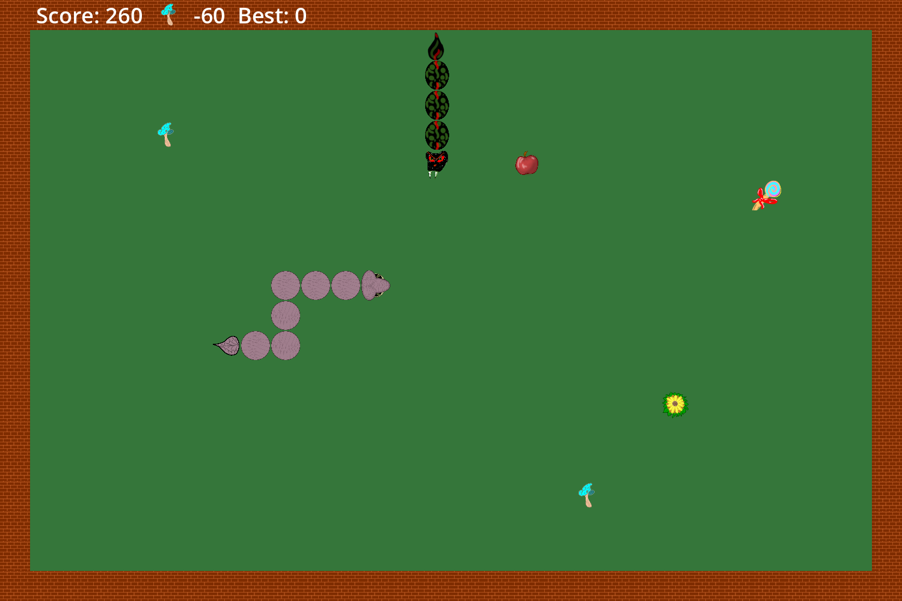
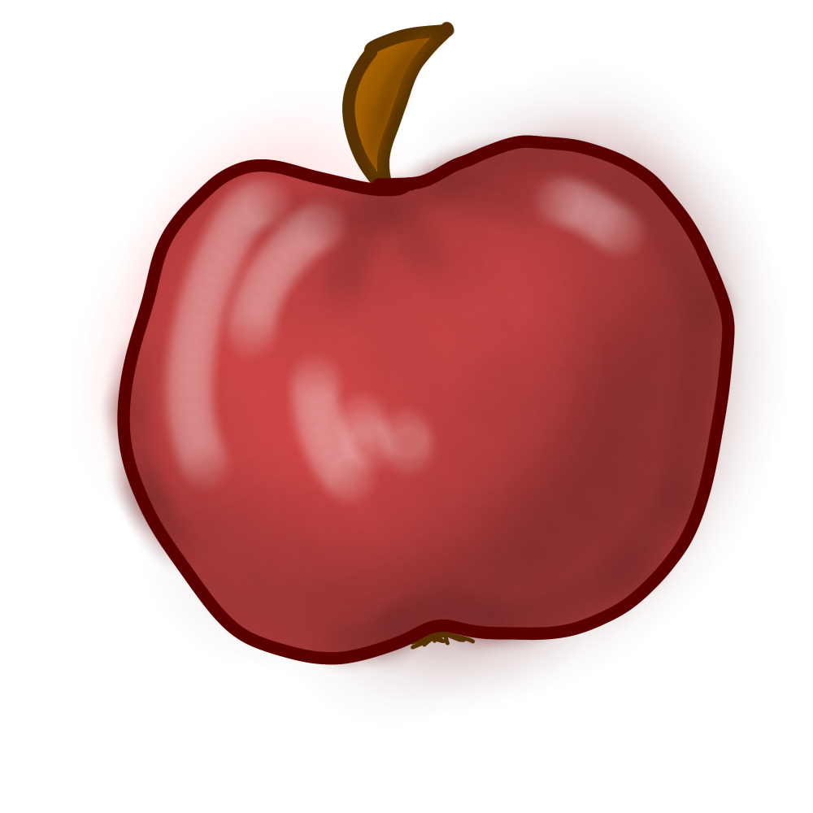
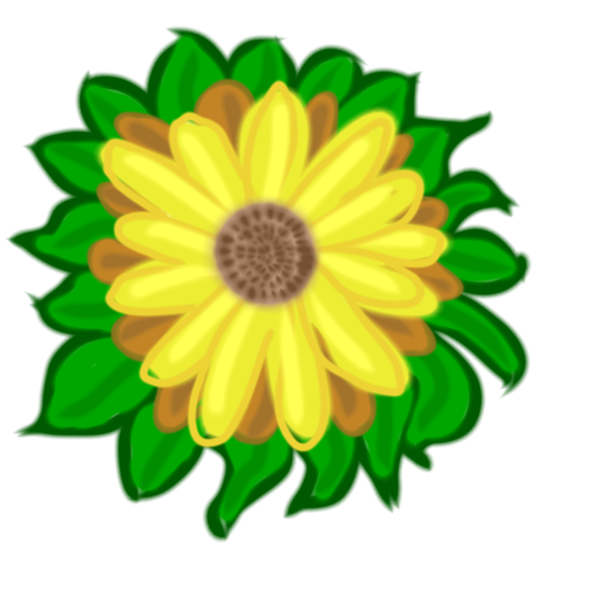
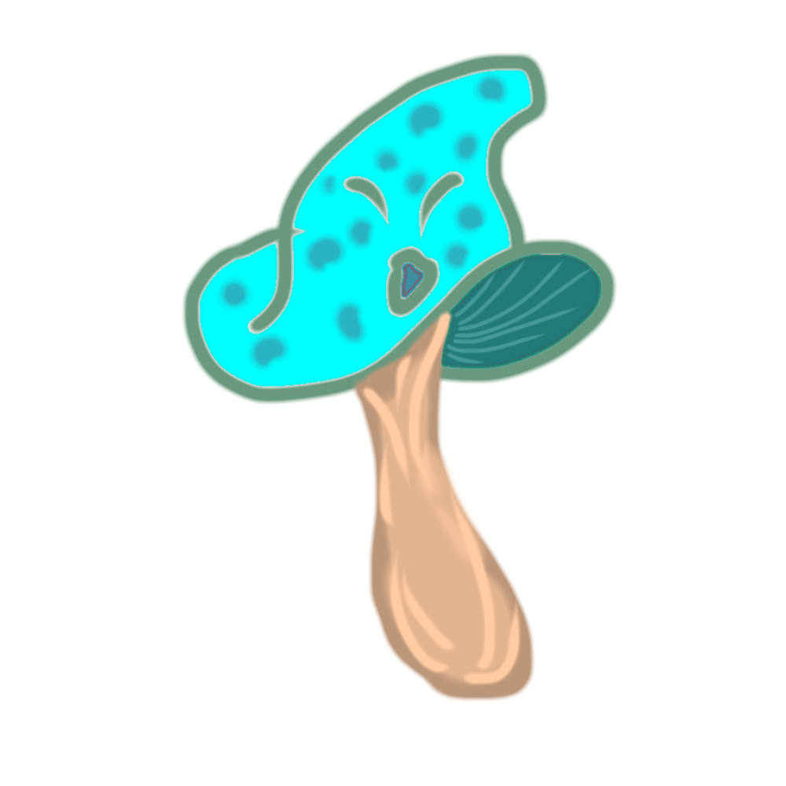
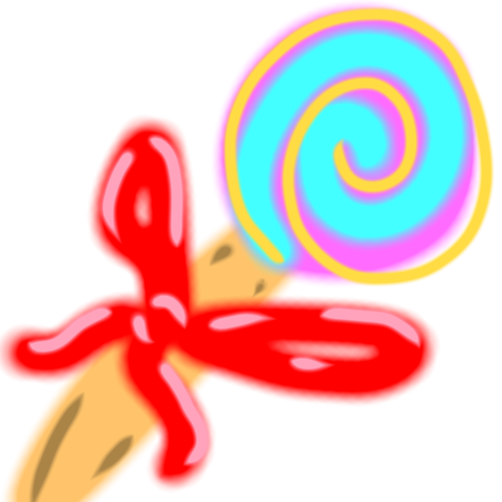
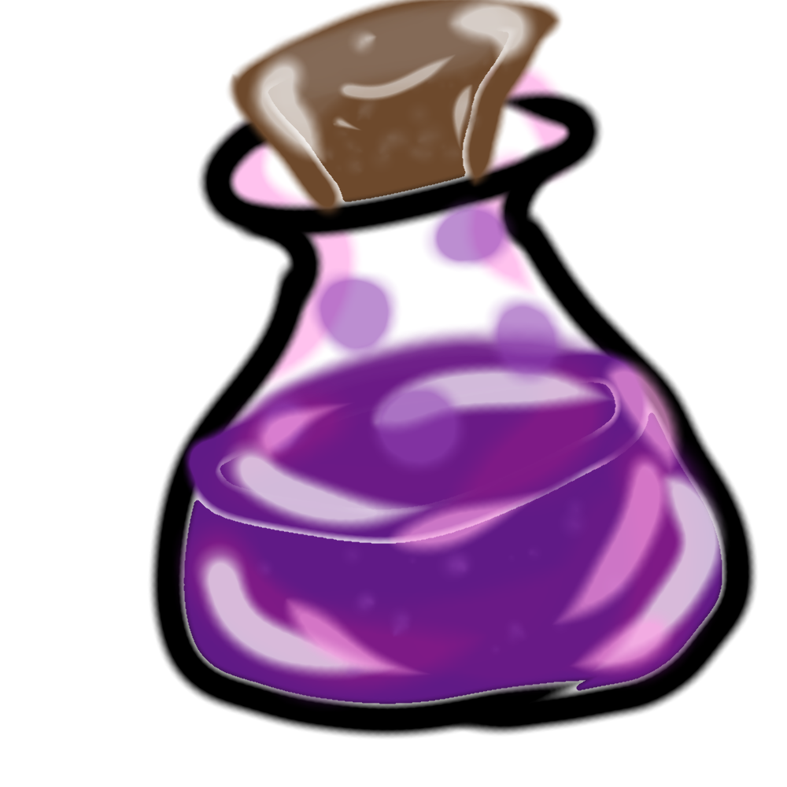
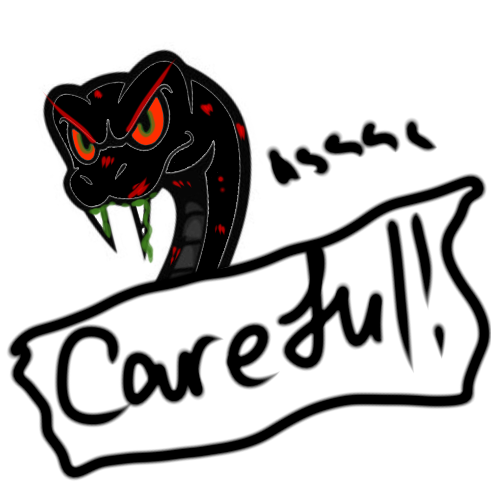

# Who's the Bad SNAKE?

A twist on classic Snake, made with **Godot 4** and **GDScript**.
Eat, grow, dodge poison — and trap the evil snake that crawls out of a portal every 30 seconds.

## How to play

| Key | Action |
|---|---|
| Arrow keys | Move |
| Enter / Space | Start, next tutorial page, play again |
| Esc | Skip the tutorial |

You lose if you hit a **wall**, **your own body**, or **the bad snake's** body with your head — or if your **score drops below 0**.

## Items

| | Item | Effect |
|---|---|---|
|  | **Apple** | +10 points, snake grows |
|  | **Sunflower** | +50 points, snake grows — disappears quickly |
|  | **Poison mushroom** | −30, then −60, −120… each one hurts twice as much |
|  | **Candy** | 1.5× speed for 5 seconds |
|  | **Purple potion** | Next mushroom gives **+500** and cures the poison. Eating anything else first wastes it |

## The bad snake

Every 30 seconds a wall starts flashing **"Careful!"** and a bad snake comes out of a portal, moving in a straight line.

- Hit it with your head → **you die**
- Make it crash into your **body** → **it dies** and drops the only purple potion in the game

## Features

- Grid-based movement with a tick timer, no turning back on yourself
- Timed items that blink before they disappear
- Doubling poison penalty shown live in the top bar
- Enemy snake with warning, spinning portal, and trapping mechanic
- High score saved between sessions (`user://save.cfg`, works in the browser too)
- Title screen and illustrated tutorial
- Original hand-drawn art and sound effects

## Run it yourself

1. Install [Godot 4.7](https://godotengine.org/download)
2. Clone this repo and open `project.godot` in Godot
3. Press **F5**

## Credits

- **Game design, code, art & sound effects:** [enkhjee](https://github.com/enkhjee) (sound effects made with ChipTone)
- **Music:** ["FM Fun" by sla97](https://opengameart.org/content/fm-fun), licensed [CC-BY 4.0](https://creativecommons.org/licenses/by/4.0/)
